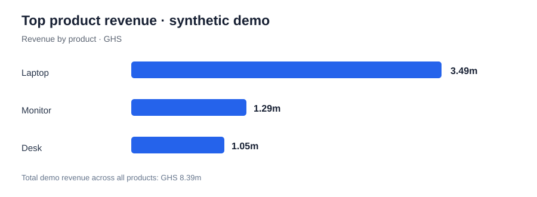
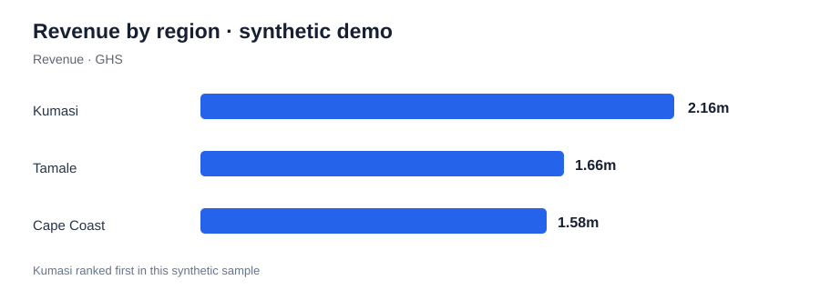

[](https://github.com/Mrroof/sales-revenue-analysis/actions)

# Sales and Revenue Performance Analysis

> **Portfolio case study · Python · pandas · Matplotlib · SQL · Power BI extension**

## Executive summary
This project analyzes synthetic sales transactions to compare revenue and gross profit across products and regions, and to demonstrate how transaction-level data can be transformed into business reporting.

## Business questions
- Which products contribute most to total revenue?
- Which regions generate the most revenue and gross profit?
- How do product mix and transaction trends inform commercial questions?
- What measures would be useful in a Power BI dashboard?

## Demonstration findings
- Total demo revenue: **GHS 8,389,891.74**.
- Laptops generated the largest product revenue: **GHS 3,487,963.36**.
- Kumasi generated the highest regional revenue: **GHS 2,159,211.18**.
- Laptop gross profit in the demo dataset was **GHS 885,400.29**.





## Method
1. Load and validate transaction records.
2. Calculate revenue, cost and gross profit.
3. Aggregate performance by product, region and month.
4. Export summary tables and visualizations.
5. Use the outputs to formulate follow-up commercial questions.

## Run locally
```bash
pip install -r requirements.txt
python src/analyze_sales.py
```

Outputs are written to `outputs/`.

## Power BI extension
Import the CSV or exported summary tables and create measures for Total Revenue, Total Cost, Gross Profit, Gross Margin %, and Units Sold. Add month, region and product slicers.

## Limitations
The transactions are synthetic and do not represent actual company sales. Revenue rankings and trends are illustrative only. A business recommendation would require understanding discounts, returns, customer segments, inventory constraints, acquisition costs and data quality.

## Repository structure

```text
data/sales_demo.csv                 # Synthetic transaction records
src/analyze_sales.py                # Data preparation and analysis
sql/analysis_queries.sql            # Example SQL analysis queries
docs/                               # Report-ready charts
requirements.txt                    # Python dependencies
.github/workflows/                  # Automated repository validation
```

## Reproducibility

Run the command above from the repository root. The script regenerates summary outputs locally in `outputs/`; generated outputs are not committed by default. SQL examples are provided separately for readers who want to explore the same business questions in a relational database.
